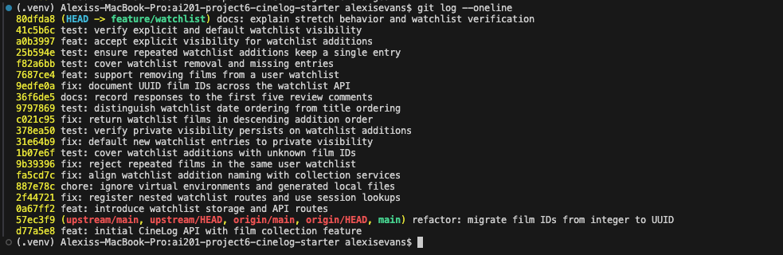

# PR Response Doc — CineLog Watchlist Feature

## git log --oneline



## AI Usage

I used AI to inspect the codebase and review my responses. For Comment 4, I chose private-by-default and wrote the reasoning first; AI helped clarify the distinction between a stored visibility flag and access control, added a regression test, and updated the implementation and verification notes. My final position remains based on my expectation that saving a film records a personal viewing intention. For Comment 5, I chose newest-first and wrote my reasoning before AI assistance. AI preserved that decision, documented the ordering, and added a regression test using explicit timestamps and titles whose alphabetical order differs from their date-added order. For the stretch work, AI implemented removal and explicit visibility, added service and endpoint tests, updated this document, and created separate conventional commits for implementations, tests, and documentation.

## Comment 1 — Rename

**What I did:** I renamed the service function and updated its import and call in `routes/watchlist/watchlist.py`.

**How I verified:** I did a search for the name "save_to_watchlist" in the source files under services/ and routes/ and it returned no results, meaning I had successfully replaced every instance of the function in the code.

## Comment 2 — Deduplication

**What I did:** I amended the way `add_to_watchlist()` adds new films. Now, the watchlist does not allow duplicate entries. Similar to in `add_to_collection()`, it queries for an existing WatchlistEntry matching both the `user_id` and `film_id`. It raises `AlreadyInWatchlistError` (mirroring `AlreadyInCollectionError`) when a duplicate exists before inserting.

**How I verified:** `test_add_to_watchlist_duplicate_raises` adds the same film twice for one user, expects `AlreadyInWatchlistError`, and confirms exactly one entry remains with the original ID. The full suite passes.

## Comment 3 — Missing test

**What I did:** I wrote a test mirroring `test_add_to_collection_nonexistent_film_raises(app, sample_user):` but for my add_to_watchlist() function.

**How I verified:** I ran the test suite and all five tests including the new missing film test passed. I tested using:

```Shell
python -m pytest tests/ -v
```

## Comment 4 — Default visibility

**My position:** `WatchlistEntry.public` should default to `False`.

**Reasoning:** I believe that when a user adds something to their watchlist, it isn't something they are thinking will be publicized. What if a user was using their watchlist for their own personal use, and don't want to broadcast every movie they intend to watch, only ones that they did? I'd think saving a movie usually is intended as "save this for me, not publicly."

**Tradeoff acknowledged:** Users would lose the convenience of having their watchlist entries publicly visible immediately after adding them. If a user wants their watchlist public to be social, that would add an extra step to share entries on the user's end. CineLog is intended to be a social platform, and this does remove a level of sharing, but I think it's necessary for more user privacy and matching user assumptions closer.

**What I changed:** Changed `WatchlistEntry.public` in `models.py` from `default=True` to `default=False`. `add_to_watchlist()` now also defaults its explicit `public` parameter to `False`, matching the model default, and passes that value to new entries. This applies to new entries; it does not change existing entries. The explicit visibility parameter is implemented in the stretch work below.

**How I verified:** Added `test_add_to_watchlist_defaults_to_private` in `tests/test_watchlist.py`. It adds a valid film through the service, expires the session's cached state, and verifies that the persisted entry and its serialized response both have `public=False`. Ran `python -m pytest tests/ -v`: all six tests passed.

**Current limitation:** The visibility flag records the intended sharing preference. The existing GET endpoint returns all entries for a supplied user ID and does not enforce private access. This default change alone does not prevent other callers from reading entries.

## Comment 5 — Sort order

**My position:** Sort by newest first.

**Reasoning:** It keeps the recently saved interests visible, and it also matches the collections behavior. However, known titles are harder to locate in long lists.

**Engagement with reviewer's point:** I would agree that most users would want to see what they added recently so they know what they wanted to see most recently. I think it will be easier for users to find movies in their watchlist by keeping their recent interests in the foreground of their mind as they search their watchlists.

**What I changed:** Changed `get_watchlist()` in `services/watchlist_service.py` to order by `WatchlistEntry.date_added.desc()` instead of `Film.title.asc()`, and documented newest-first behavior in its docstring. The existing GET endpoint uses this service, so it returns the same ordering.

**How I verified:** Added `test_get_watchlist_returns_newest_first` in `tests/test_watchlist.py`, following the collection sort-test pattern. It assigns fixed timestamps to an older Alien entry and a newer Spirited Away entry, then asserts that Spirited Away comes first. Alphabetical ordering would return the opposite result. Ran `python -m pytest tests/ -v`: all seven tests passed.

## Comment 6 — Rebase

**What conflicted:** During the rebase onto `origin/main`, `models.py` conflicted because the watchlist branch retained integer film IDs while main had migrated film IDs to UUID strings.

**How I resolved it:** Kept main's UUID definitions for `Film.id` and `CollectionEntry.film_id`, and used `db.String(36)` for `WatchlistEntry.film_id` while preserving its foreign key and index. Preserved the watchlist relationships and serialization, and the later private-default change. After completing the rebase, updated the service argument documentation and endpoint request example to describe UUID strings. The model resolution was incorporated into the replayed feature commit; the remaining UUID documentation updates are ready for a separate `fix:` commit.

**How I verified no conflict remains:** Confirmed `origin/main` is an ancestor of the feature branch, no merge commits appear in `origin/main..HEAD`, and no conflict markers remain in the tracked Python and Markdown files. Ran `python -m pytest tests/ -v`: all seven tests passed. Also created a fresh in-memory database and verified that a generated film ID parses as a UUID, round-trips through the watchlist service, and is backed by string columns for all three film-ID fields. `git diff --check` passed.

## Stretch Features

### Remove a watchlist entry

Implemented `remove_from_watchlist(user_id, film_id)` and `NotInWatchlistError` in `services/watchlist_service.py`, following `remove_from_collection()`. The lookup matches both IDs so removal affects only the specified user's entry. It deletes and commits the matching entry and returns `True`; an absent entry raises `NotInWatchlistError`, including repeated removal and unknown film IDs. Like the collection service, duplicate additions are rejected separately by the existing add operation. No DELETE endpoint was added; this stretch feature is a service function.

Tests cover successful removal while preserving another user's entry for the same film, repeated removal, and an unknown film UUID.

### Additional edge-case test

Added `test_add_to_watchlist_duplicate_raises`. I chose this case to verify Comment 2's deduplication behavior: it must raise the domain error and preserve exactly one original row, rather than merely reporting an error after inserting a duplicate.

### Explicit visibility

Added `public=False` to `add_to_watchlist()` and an optional JSON `public` field to `POST /watchlist/<user_id>/add`. JSON `true` and `false` are persisted explicitly; omitting the field keeps the private default chosen in Comment 4. The endpoint returns HTTP 400 for non-boolean values, including strings, numbers, null, arrays, and objects. Direct service callers receive `ValueError` for invalid visibility values. A duplicate addition still raises the existing duplicate error rather than updating an entry's visibility.

Tests cover both explicit boolean values through the endpoint and database, the omitted-field default, rejected non-booleans without insertion, and invalid direct service calls. Visibility remains a stored preference; the existing GET endpoint does not enforce access control.

**Verification:** `python -m pytest tests/ -v` passes all 24 tests. `git diff --check` passes. Implementations, tests, and documentation are committed separately using conventional messages.

## PR Description

CineLog's watchlist lets users save films they intend to watch and retrieve them with visibility and date-added metadata. The service prevents repeated additions for a user and supports removing saved entries. Callers can explicitly choose visibility when adding a film.

### Default visibility decision

New watchlist entries default to private (`public=False`). Saving a film records a user's intention to watch it, which I do not consider an automatic decision to share that intention. For CineLog's community features, this reduces automatic discovery and requires an extra sharing step; I accept that tradeoff to better match the expectations described in Comment 4. This sets the stored visibility preference; access control is not implemented by this change.

### Sort-order decision

Watchlists return entries by date added, newest first. This follows the reviewer's suggestion to surface recent additions and matches the collection service. Recent saves act as reminders of current viewing interests. The tradeoff is that finding a known title in a long list is less convenient than with alphabetical ordering.

### Manual testing

1. Use a fresh UUID-based demo database, activate the virtual environment, and run `python seed.py`. Record the printed demo user UUID. Start the API with `python app.py`.
2. Run `curl http://127.0.0.1:5000/films/` and copy two film UUIDs. Replace `USER_UUID` and `FILM_UUID` in the following requests with actual values.
3. Add the first film with explicit public visibility:
   ```bash
   curl -i -X POST http://127.0.0.1:5000/watchlist/USER_UUID/add \
     -H 'Content-Type: application/json' \
     -d '{"film_id":"FILM_UUID","public":true}'
   ```
   Expect HTTP 201 and `public: true`.
4. Add the second film with a different UUID and omit `public`. Expect HTTP 201 and `public: false`. For explicit private visibility, send `"public":false` on a fresh addition.
5. Run `curl http://127.0.0.1:5000/watchlist/USER_UUID`. Confirm both films appear, with the second addition first and the expected visibility values.
6. On a fresh addition, send `"public":"false"` (a string). Expect HTTP 400 and `public must be a boolean`; the film should not be inserted.
7. To exercise removal manually, stop the server and run `python` in the activated environment:
   ```python
   from app import create_app
   from services.watchlist_service import remove_from_watchlist, get_watchlist
   app = create_app()
   with app.app_context():
       print(remove_from_watchlist("USER_UUID", "FILM_UUID"))
       print(get_watchlist("USER_UUID"))
   ```
   Use the real IDs of a saved entry. Expect `True` and a list without that film. Repeating removal raises `NotInWatchlistError`.
8. Run `python -m pytest tests/ -v` for automated checks, including duplicate and nonexistent-film handling. The add endpoint currently does not translate those service errors into 404/409 responses; that behavior was outside the stretch changes.
